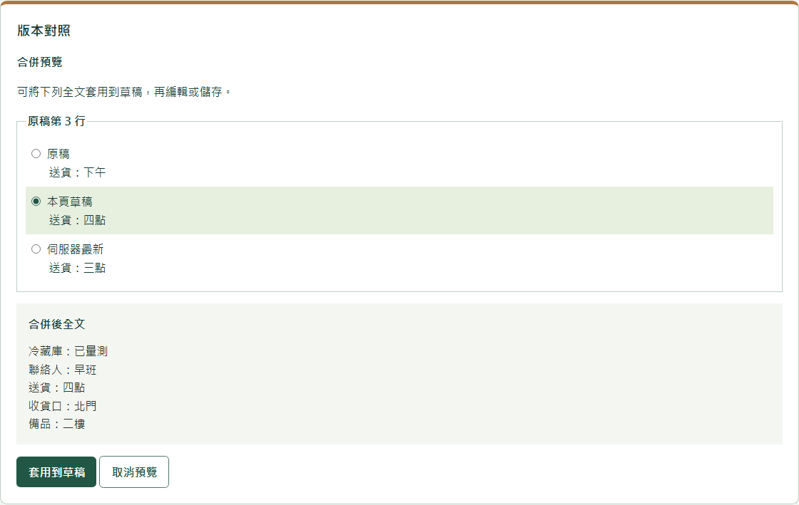

# 交班與排班工作台

把交班紀錄、跨時區排班、值班人力與文稿覆核放在同一個維運入口。[工具入口與各模組的重跑方式](modules/README.md)。

兩個班別在瀏覽器裡編輯同一份交班紀錄。如果有人先儲存，後送出的草稿會留在編輯區。接班者可以對照原稿與最新版本，也可以預覽三方合併，自動保留互不重疊的修改，逐處選擇衝突段落。範例使用繁體中文介面與真實的 [Handoff Notes API](https://github.com/peca12968/handoff-desk/tree/033d91434d169d557d438ddd11c0a87fc5f7c4e5)。



## 在本機重現

需要 Git、.NET 10 SDK 與 Node.js 24。從同一份儲存庫，在第一個終端機啟動 API。

```sh
git clone https://github.com/peca12968/handoff-desk.git
cd handoff-desk/modules/handoff-notes-api
dotnet restore src --locked-mode
dotnet build src -c Release --no-restore
dotnet src/bin/Release/net10.0/HandoffNotes.dll --urls http://127.0.0.1:5087
```

在第二個終端機從同一父目錄啟動前端。

```sh
cd handoff-desk
npm ci
npm run dev
```

開啟 `http://127.0.0.1:4177`，依序操作。

1. 輸入「冷藏庫溫度已記錄」，按「建立紀錄」，再按「在新分頁開啟」。
2. 在第一個分頁追加「早班已換感測器」並儲存。在第二個分頁追加「晚班待複查」並儲存。第二個分頁會出現版本對照。
3. 保留晚班文字，把早班的更新加入編輯區，按「儲存合併結果」。重新整理第一個分頁，即可看到雙方修改。

## 版本與草稿

每次讀取都保存當時的內容、版號與 ETag。編輯器儲存時用 `If-Match` 帶回使用者看過的版本。收到 HTTP 412 後會取得最新內容並保留本頁草稿。使用者按下合併按鈕時，編輯器會帶上對照欄的 ETag。若第三筆修改搶先寫入，頁面會重新開啟對照，剛才整合的文字仍在編輯區。[編輯流程](ui/desk.js)

此示範透過綁定本機的 Vite 代理連線至 SQLite API，信任同一台電腦上的使用者。尚未儲存的草稿與編輯依據保存在該分頁的 `sessionStorage`，同一分頁重新整理後可繼續編輯。透過「在新分頁開啟」另開的編輯器從伺服器讀取已儲存內容。分頁關閉前，編輯器會向瀏覽器申請離開提示。

### 斷線後復原草稿

既有紀錄重新整理後若暫時讀不到伺服器，仍可編輯復原的草稿。重新讀取成功後，工作台以草稿的原始 ETag 和伺服器最新版本核對。伺服器已有新內容時，可利用版本對照整合。若伺服器已儲存相同文字，例如上次寫入成功但回應中斷，編輯器會載入最新版並清除備份。瀏覽器阻擋儲存空間時，頁面會提示先複製尚未備份的內容。[作品站與端對端測試共用的案例資料](examples/draft-recovery.json)

## 用鍵盤完成一次衝突合併

三方合併使用固定版本的 Draft Weave 比對原稿、本頁草稿和伺服器最新內容。例如冷藏庫量測與備品位置各由一班更新，兩項可以同時保留。兩班把同一行送貨時間分別改成三點和四點，預覽就列出這一行的三個版本。完成選擇後按「套用到草稿」，仍可繼續編輯。按「儲存修改」才會送出。[合併實作](ui/merge-review.js) · [Draft Weave 固定版本](https://github.com/peca12968/handoff-desk/tree/d13d5828ab2ba4777f48bc95b20eee9b84bbdda3)

如果第三人在預覽期間改了收貨口，下一次儲存會重新開啟對照。再預覽一次即可把新的收貨口納入剛選好的送貨時間。合併後超過 16,384 個 UTF-8 位元組時，可以在草稿內縮短文字。超過演算法比較上限時，仍可手動整合。[含四版歷史核對的瀏覽器測試](tests/merge.spec.js)

### 手動整合

在較早開啟的分頁修改草稿，以 Tab 移到「儲存修改」並按 Enter。若另一班已寫入新版，焦點會落在「版本對照」標題。閱讀兩版內容後，按 Tab 到「返回草稿編輯」，再按 Enter 即可繼續編輯。合併成功時焦點回到編輯區。若送出時斷線，焦點回到儲存按鈕，恢復連線後可直接按 Enter 重試。

測試先讓早班存入第 2 版，再以晚班的舊草稿觸發 HTTP 412。它使用作品集內的 Focus Receipt 比對八次按鍵後的焦點，最後從 SQLite 歷史 API 讀回第 3 版，核對兩班文字都已保存。另一個測試延後伺服器回應，確認等待期間已移到其他連結的焦點會留在原處。[鍵盤整合測試](tests/desk.spec.js) · [Focus Receipt 固定版本](https://github.com/peca12968/handoff-desk/tree/e339536fcfaba6cd909cd43234a3ebd723e23eb8)

## 自動化驗證

保留已建置的 API，先結束上述兩個示範服務，再在前端目錄執行以下指令。Playwright 會啟動獨立 API 與前端預覽，每次執行使用新的本機測試資料庫。

```sh
npm run build
npx playwright install chromium firefox
npm test
```

Chromium 與 Firefox 共用同一套案例，涵蓋三方合併、鍵盤與焦點、連續寫入衝突、窄螢幕、UTF-8 大小邊界，以及離線重新整理、分頁草稿隔離和寫入成功後回應中斷。測試透過歷史 API 讀回 SQLite 各版紀錄並逐字核對。GitHub Actions 在 Ubuntu 重跑相同測試。[編輯器測試](tests/desk.spec.js) · [三方合併測試](tests/merge.spec.js) · [CI](.github/workflows/system.yml)

**履歷用語**　以 JavaScript、HTTP ETag 與 Playwright 實作交班編輯器，保留衝突草稿並提供版本對照，透過兩個瀏覽器分頁與 SQLite 整合測試驗證連續衝突後的四版歷史。

本專案使用 AI 輔助開發。交班內容使用合成範例。

[同庫模組與整合測試](modules/README.md)
